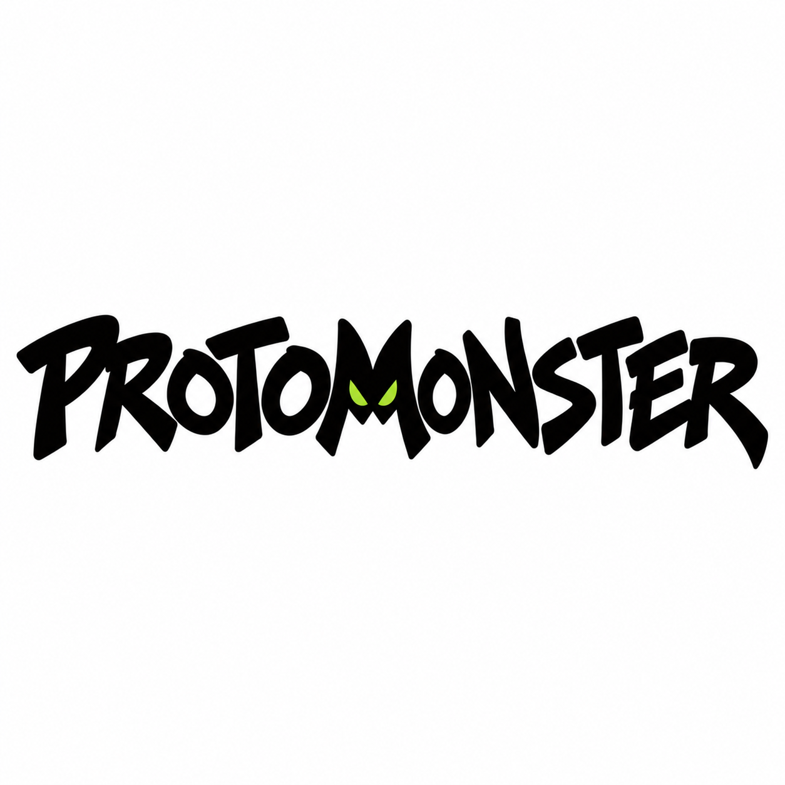

<p></p>

# Protomonster 1.200

Маркерный display-шрифт для коротких фраз и крупных заголовков. Латиница и кириллица, настоящие строчные буквы, 259 Unicode-символов и 261 глиф.

[Скачать комплект 1.200](https://github.com/michaelbrowk/protomonster-typeface/releases/download/v1.200/Protomonster-Family-1.200-Release.zip) · [Интерактивный specimen](specimen.html) · [Превью](preview.png)

## Начертания

| Файл | Вес |
| --- | --- |
| Variable | 400–700, по умолчанию 500 |
| Regular | 400 |
| Medium | 500 |
| Bold | 700 |

В комплекте Variable TTF / WOFF2 и три статических начертания в TTF / OTF / WOFF2.

## Установка

Для плавного выбора веса установите [Variable TTF](Protomonster-Variable.ttf), если приложение поддерживает variable fonts. Либо установите три статических TTF: [Regular](Protomonster-Regular.ttf), [Medium](Protomonster-Medium.ttf), [Bold](Protomonster-Bold.ttf). Выберите один вариант установки, чтобы избежать дубликатов семейства.

Для локального просмотра скачайте комплект, распакуйте и откройте `specimen.html`. В нём можно менять текст, вес, размер, интервалы и фон.

## На сайте

Разместите `protomonster.css` и `Protomonster-Variable.woff2` рядом, затем подключите CSS:

```html
<link rel="stylesheet" href="./protomonster.css">
<h1 class="protomonster">Привет, монстр!</h1>
```

Вес меняется непрерывно через `font-weight: 400` … `700`. CSS использует 500 по умолчанию и отключает искусственное утолщение. Класс `protomonster-monster` включает вариант M / М с глазами (`ss01`):

```html
<h1 class="protomonster protomonster-monster">Монстр!</h1>
```

[Полный постер](specimen.png) · [Контрольные суммы SHA-256](SHA256SUMS)
